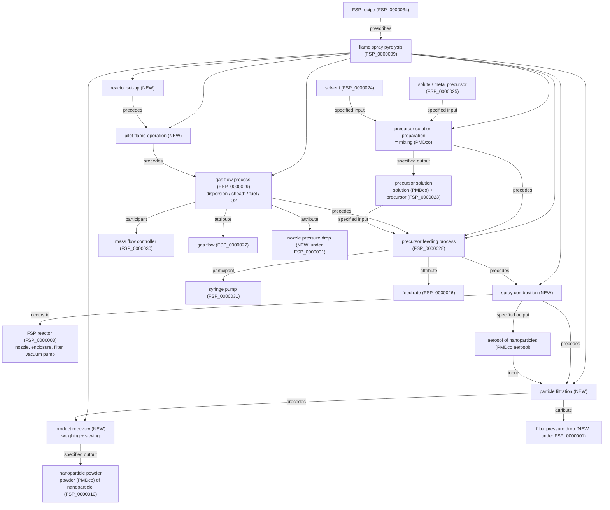

# Flame Spray Pyrolysis (FSP): process description, process model and term list

Basis: the IWT ELN template `ELN_FSP_template` (elabFTW, 2024-12-17), the FSP glossary
(`FSP glossory.ods`), the mapping notes (`fsp_mapping/doubts.odt`) and the current
`fsp-edit.owl` (FSP_0000001–FSP_0000034). Terms were checked against `fsp-edit.owl`
and the current PMDco (`src/ontology/mirror/pmdco.owl`, 2026-10-21).

> The step order in section 1 is the usual FSP start-up / shut-down practice.
> Please confirm it with the operators of the IWT reactor (open question 3 in `doubts.odt`).

---

## 1. The process, step by step

FSP makes nanoparticles in one step: a liquid containing dissolved metal compounds is
sprayed into a flame, the droplets burn, and the metal ends up as solid nanoparticles
(usually oxides) that are collected on a filter.

| # | Step | What happens | Recorded in the ELN |
|---|------|--------------|---------------------|
| 0 | **Planning** | Goal of the experiment, choose recipe, assign sample IDs. | title, date, experimenter, assistant, goal, sample ID |
| 1 | **Precursor solution preparation** (mixing) | The metal precursor (e.g. a metal-organic salt such as a 2-ethylhexanoate or nitrate) is weighed and dissolved in a solvent (e.g. xylene, ethanol, 2-ethylhexanoic acid) with a pipette, to a target molarity. | element, precursor (metal) + provider + LOT, precursor (solvent) + provider + LOT, mass of metal precursor [g], volume of solution [ml], molarity [M] |
| 2 | **Reactor set-up** | Choose and mount the nozzle (Tethis or SpraySyn), set its position: nozzle-filter distance, nozzle angle, and for two flames the nozzle-nozzle / horizontal distance. Weigh and mount the empty glass-fibre filter, close the enclosure (closed reactor) or not (open reactor). | nozzle type, nozzle-filter distance [cm], nozzle angle [°], horizontal nozzle distance [cm], empty filter [g] |
| 3 | **Start gas flows and pilot flame** | Start the vacuum pump (draws gas through the filter). Start the **sheath gas** (shields the flame and protects the reactor). Start the **fuel gas** (e.g. CH₄) and **O₂ for the pilot flame** via mass flow controllers and ignite the small ring-shaped pilot flame. | sheath gas type/purity/flow [l/min], fuel gas type/purity/flow [l/min], O₂ purity/flow (pilot) [l/min] |
| 4 | **Start dispersion gas, set pressure drop** | The **dispersion gas** (usually O₂) flows through the narrow ring gap around the capillary. The gap is adjusted until the **pressure drop at the nozzle** reaches its target (typically 1.5 bar). | dispersion gas type/purity/flow [l/min], pressure drop at nozzle [bar] |
| 5 | **Precursor feeding** | A syringe pump pushes the precursor solution through the capillary at a constant **feed rate**. | precursor feed rate [ml/min] |
| 6 | **Atomisation** | The fast dispersion gas tears the liquid jet into fine droplets: a spray (aerosol of droplets). | (controlled by 4 and 5) |
| 7 | **Spray flame: combustion and particle formation** | The pilot flame ignites the spray. Droplets evaporate, the solvent and the metal compound burn, metal oxide molecules form (**chemical reaction**), **nucleate** into clusters, **grow** by collision (**coagulation**) and fuse (**sintering / coalescence**) into primary particles that stick together as **aggregates / agglomerates**. | not measured directly; determined by steps 1–5 |
| 8 | **Particle collection** (filtration) | The vacuum pump draws the particle-laden off-gas through the filter. Particles build up a cake, so the **filter pressure drop** rises during the run. | final pressure drop [mbar] |
| 9 | **Shut-down** | Stop precursor feed (often flush the capillary with pure solvent), stop dispersion gas, pilot flame gases, sheath gas, then the pump. | – |
| 10 | **Product recovery** | Weigh the covered filter, scrape off the powder, **sieve** it and weigh the product. | covered filter [g], sieving grid [µm], product after sieving [mg] |
| 11 | *(Characterisation)* | BET, XRD, TEM, … – separate assays, outside this ontology for now. | – |

**Set-up variants** (from the ELN and `doubts.odt`): open or closed reactor; single, double
(front/back) or triple flame; one or several nozzles. In the double-flame set-up steps 1–8
exist **once per flame** (Flame 1 front, Flame 2 back).

---

## 2. Process model (PMDco style)

Modelling pattern, following PMDco:

| What | How | Example |
|------|-----|---------|
| Steps | subclasses of `manufacturing process` / `process`, linked by `has occurrent part` (BFO_0000117) to the whole FSP run, ordered by `precedes` (BFO_0000063) | precursor feeding *precedes* spray combustion |
| Materials in / out | `has specified input` (OBI_0000293) / `has specified output` (OBI_0000299) | mixing → precursor solution |
| Devices | `has participant` (RO_0000057) | precursor feeding — syringe pump |
| Process parameters (flow, feed rate, pressure drop) | `process attribute` (PMD_0000008) linked to the process by `has characteristic` (RO_0000053), value via `has value specification` (OBI_0001938) → `scalar value specification` | gas flow process — gas flow = 5 l/min |
| Material / device properties (molarity, purity, distances, angle, mass) | qualities, `has quality` (RO_0000086) | precursor solution — molarity = 0.5 M |
| Set values before the run | the FSP recipe (FSP_0000034) holds the nominal values (`parameter specification`), the run holds the measured ones | |

---

## 3. Term list

Legend:
- **FSP**: already in `fsp-edit.owl`.
- **PMDco ✓**: in PMDco and already imported (in `pmdco_terms.txt` or pulled in as a parent).
- **PMDco +**: in PMDco but not imported yet; add the IRI to `src/ontology/imports/pmdco_terms.txt`.
- **External**: from another ontology (ChEBI for chemicals; IDs checked in OLS).
- **NEW**: missing everywhere; create as an FSP term (next free ID: FSP_0000035).
- **⚠**: exists, but the existing term means something else or should be revised.

### 3.1 Processes

| Term | Status | IRI / proposed parent | Note |
|------|--------|-----------------------|------|
| flame spray pyrolysis | FSP | FSP_0000009 ⊂ FSP_0000008 | whole run |
| nanoparticle synthesis | FSP | FSP_0000008 ⊂ manufacturing process | |
| manufacturing process | PMDco ✓ | PMD_0000833 | |
| mixing (precursor solution preparation) | PMDco + | PMD_0000778 | use directly or as parent of "precursor solution preparation" |
| reactor set-up | NEW | ⊂ process (BFO_0000015) | mounting nozzle and filter, setting distances |
| gas flow process | FSP | FSP_0000029 ⊂ continuous transport | one per gas |
| precursor feeding process | FSP | FSP_0000028 ⊂ continuous transport | |
| continuous transport | PMDco ✓ | PMD_0020246 | label typo in PMDco: "continous" |
| pilot flame operation | NEW | ⊂ process | burning premixed fuel gas + O₂ |
| atomisation | NEW | ⊂ process | droplet formation at the nozzle |
| spray combustion | NEW | ⊂ chemical reaction | the spray flame |
| chemical reaction | PMDco + | PMD_0000869 | parent for combustion |
| evaporation | NEW | ⊂ change of aggregate state | droplet / solvent evaporation |
| change of aggregate state | PMDco + | PMD_0000547 | |
| nucleation | NEW | ⊂ process | particle formation from vapour |
| coagulation | NEW | ⊂ process | particle collisions |
| particle sintering / coalescence | NEW | ⊂ process | ⚠ do **not** use PMDco `sintering` (PMD_0000934): that is the manufacturing process for pressed powder parts |
| particle filtration | NEW | ⊂ separating (PMD_0000927, PMDco +) or ⊂ process | decide: PMDco "separating" is defined as breaking cohesion of objects, so check whether it fits |
| shut-down / nozzle flushing | NEW (optional) | ⊂ cleaning (PMD_0000560, PMDco +) | only if you need it in the data |
| product recovery | NEW | ⊂ process | scraping powder off the filter |
| weighing (mass measurement) | NEW | ⊂ assay (OBI_0000070) | not in PMDco; OBI has mass-measurement assays to check |
| sieving | NEW | ⊂ separating or ⊂ process | |

### 3.2 Materials (inputs, outputs, gases)

| Term | Status | IRI / proposed parent | Note |
|------|--------|-----------------------|------|
| precursor | FSP | FSP_0000023 ⊂ fluid (object) | ⚠ "precursor" is really a **role** a material plays; the glossary already noted that `solution` could be used |
| precursor solution | PMDco ✓ | solution PMD_0020229 | ⚠ consider: precursor solution = solution that bears a precursor role |
| solvent | FSP | FSP_0000024 ⊂ fluid (object) | ⚠ PMDco `solution` already defines solvent as a role |
| solute (metal precursor) | FSP | FSP_0000025 ⊂ object (BFO) | |
| metal-organic compound | NEW or External | chemical substance (CHEBI_59999, PMDco ✓) | "Metall Organic" appears in `FSP_r2c.py` |
| metal (element of the product) | PMDco + | PMD_0000852 | |
| portion of pure chemical element | PMDco + | PMD_0020140 | for the "Element" column |
| fluid (object) | PMDco ✓ | PMD_0020113 | |
| gas | PMDco ✓ | PMD_0020289 | |
| dispersion gas | FSP | FSP_0000007 ⊂ fluid (object) | better parent: gas (PMD_0020289) |
| oxidation gas | FSP | FSP_0000005 ⊂ fluid (object) | better parent: gas |
| fuel gas | FSP | FSP_0000006 ⊂ fluid (object) | better parent: gas |
| sheath gas | FSP | FSP_0000004 ⊂ fluid (object) | better parent: gas |
| oxygen (O₂) | External | CHEBI_15379 dioxygen; PMDco has `portion of oxygen` PMD_0020091 | gas *type* value |
| methane (CH₄) | External | CHEBI_16183 | typical fuel gas |
| nitrogen (N₂) | External | CHEBI_17997 dinitrogen; PMDco `portion of nitrogen` PMD_0020038 | typical sheath gas |
| xylene / ethanol / 2-ethylhexanoic acid | External | CHEBI_27338 / CHEBI_16236 / CHEBI_89058 | typical solvents |
| droplet | NEW | ⊂ portion of matter | |
| spray (droplet aerosol) | PMDco + | aerosol PMD_0020115 | |
| aerosol (particles in off-gas) | PMDco + | PMD_0020115 | |
| nanoparticle | FSP | FSP_0000010 ⊂ engineered material | |
| aggregate / agglomerate | NEW | ⊂ connected / disconnected material entity aggregate (PMD_0000890 / PMD_0000891) | |
| powder (product) | PMDco + | PMD_0000893 | collected product |
| lot | PMDco + | PMD_0020138 | LOT number of precursor / solvent |
| provider | PMDco + | organization OBI_0000245 | glossary decision |
| sample | PMDco + | sample role PMD_0000919 | role of the product |

### 3.3 Devices and components

| Term | Status | IRI / proposed parent | Note |
|------|--------|-----------------------|------|
| device | PMDco ✓ | PMD_0000602 | |
| reactor | FSP | FSP_0000002 ⊂ device | |
| flame spray pyrolysis reactor | FSP | FSP_0000003 ⊂ reactor | |
| enclosure | FSP | FSP_0000016 ⊂ component | open vs closed reactor |
| nozzle | FSP | FSP_0000017 ⊂ component | |
| Tethis nozzle | FSP | FSP_0000019 ⊂ nozzle | |
| SpraySyn nozzle | FSP | FSP_0000018 ⊂ nozzle | |
| capillary | NEW | ⊂ component, part of nozzle | precursor channel |
| annular gap (dispersion gas orifice) | NEW | site / part of nozzle | its width sets the pressure drop |
| pilot flame ring / burner | NEW | ⊂ component, part of nozzle | |
| mass flow controller | FSP | FSP_0000030 ⊂ device | |
| syringe pump | FSP | FSP_0000031 ⊂ device | |
| pump (general) | NEW | ⊂ device | common parent for syringe and vacuum pump |
| vacuum pump | FSP | FSP_0000020 ⊂ component | ⚠ siblings are devices; consider ⊂ pump |
| deposition component | FSP | FSP_0000013 ⊂ component | |
| nanoparticle filter | FSP | FSP_0000014 ⊂ deposition component | |
| GD/F filter (glass-fibre filter) | FSP | FSP_0000015 ⊂ nanoparticle filter | |
| filter holder | NEW | ⊂ component | |
| pipette | FSP | FSP_0000032 ⊂ device | |
| balance | NEW | ⊂ device | not in PMDco |
| sieve | NEW | ⊂ device | sieving grid [µm] |
| pressure gauge | NEW | ⊂ device | realises `pressure measuring function` (PMD_0000898, PMDco +) |
| component | PMDco ✓ | PMD_0020152 | |

### 3.4 Process parameters (process attributes)

| Term | Status | IRI / proposed parent | Note |
|------|--------|-----------------------|------|
| process attribute | PMDco ✓ | PMD_0000008 | |
| flow rate | PMDco ✓ | PMD_0020226 | |
| gas flow (rate) | FSP | FSP_0000027 ⊂ flow rate | l/min, per gas |
| feed rate | FSP | FSP_0000026 ⊂ flow rate | ml/min |
| mass flow rate | PMDco + | PMD_0080014 | only if mass-based |
| pressure drop | FSP ⚠ | FSP_0000001 ⊂ pressure | move under process attribute and sharpen the definition (see earlier discussion) |
| nozzle pressure drop | NEW | ⊂ pressure drop | "pressure drop at nozzle [bar]" |
| filter pressure drop | NEW | ⊂ pressure drop | "final pressure drop [mbar]" |
| duration (run time) | PMDco + | PMD_0000143 | value specification |
| flame temperature | NEW (optional) | ⊂ temperature (PMD_0000967, PMDco ✓) | only if measured |

### 3.5 Qualities and set-up geometry

| Term | Status | IRI / proposed parent | Note |
|------|--------|-----------------------|------|
| molarity | FSP | FSP_0000021 ⊂ proportion | M = mol/l |
| volume (of solution) | PMDco ✓ | PMD_0020150 | |
| mass (precursor, filter, product) | PMDco ✓ | PMD_0020133 | |
| purity | FSP | FSP_0000022 ⊂ relational quality | gas and chemical purity |
| distance | PMDco + | PMD_0000141 (geometric relational quality) | "magnitude of length of a path connecting two independent continuants" |
| nozzle-filter distance | FSP ⚠ | FSP_0000012 ⊂ length | a distance between two things: better ⊂ distance (PMD_0000141) |
| nozzle-nozzle distance | FSP ⚠ | FSP_0000011 ⊂ length | same: better ⊂ distance |
| horizontal nozzle distance | NEW | ⊂ distance | double-flame set-up |
| nozzle angle | PMDco + | angle PMD_0001035 | new subclass "nozzle angle" optional |
| number of flames | NEW | ⊂ quality of the reactor set-up | "has number of flames" in `FSP_r2c.py`; single/double/triple |
| flame position (front / back) | NEW | categorical value | ELN: Flame 1 front, Flame 2 back |
| sieve mesh size | NEW | ⊂ length | sieving grid [µm] |
| product yield | NEW | ⊂ proportion | product mass / theoretical mass |
| particle size | PMDco + / NEW | diameter PMD_0050051 | ⚠ PMDco `grain size` is for grains in a microstructure |
| specific surface area | PMDco + | PMD_0000942 | from BET (characterisation) |

### 3.6 Information entities

| Term | Status | IRI / proposed parent | Note |
|------|--------|-----------------------|------|
| recipe | PMDco ✓ | PMD_0060008 | |
| flame spray pyrolysis recipe | FSP | FSP_0000034 ⊂ recipe | nominal set values |
| mixing recipe | FSP | FSP_0000033 ⊂ recipe | |
| parameter specification | PMDco + | PMD_0000013 | ⚠ defined for workflow functions; check before use |
| scalar value specification | PMDco ✓ | OBI_0001931 | number + unit |
| identifier (sample ID) | PMDco ✓ | IAO_0020000 | |
| objective specification (goal of experiment) | PMDco ✓ | IAO_0000005 | |
| experimenter / assistant | External | not in PMDco; e.g. a person class (FOAF / schema.org) or OBI `investigation agent role` (OBI_0000202, PMDco +) | |
| date of experiment | External / annotation | dcterms:date or a time value | |

---

## 4. Summary

- **Already in FSP:** 34 terms; they cover the devices, gases, precursor terms and main parameters.
- **In PMDco, add to `pmdco_terms.txt`:** mixing, chemical reaction, change of aggregate state, aerosol, powder, lot, organization, metal, portion of pure chemical element, distance, angle, duration, mass flow rate, diameter, specific surface area, sample role, separating, cleaning, pressure measuring function.
- **External (ChEBI):** dioxygen, methane, dinitrogen, xylene, ethanol, 2-ethylhexanoic acid.
- **NEW FSP terms:** reactor set-up, pilot flame operation, atomisation, spray combustion, evaporation, nucleation, coagulation, particle sintering, particle filtration, product recovery, weighing, sieving, droplet, aggregate/agglomerate, capillary, annular gap, pilot flame burner, pump, filter holder, balance, sieve, pressure gauge, nozzle and filter pressure drop, horizontal nozzle distance, number of flames, flame position, sieve mesh size, product yield.
- **Revise:** pressure drop (parent and definition); nozzle-filter / nozzle-nozzle distance → under `distance`; the four gases → under `gas`; vacuum pump → under device/pump; precursor and solvent as roles (optional, bigger change).
